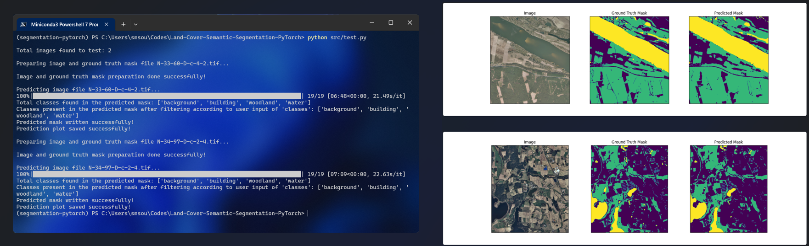
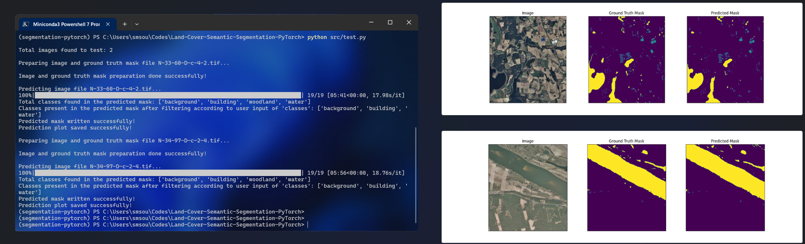

<a id="readme-top"></a>

[![Contributors][contributors-shield]][contributors-url]
[![Forks][forks-shield]][forks-url]
[![Stargazers][stars-shield]][stars-url]
[![Issues][issues-shield]][issues-url]

<!-- PROJECT LOGO -->
<br />
<div align="center">
  <h3 align="center">Land Segmentation</h3>

  <p align="center">
    Multi-class semantic land cover segmentation on aerial and satellite imagery using PyTorch and <code>segmentation-models-pytorch</code>.
    <br />
    <a href="https://github.com/aayushkarkiii/Land-Segmentation"><strong>Explore the docs »</strong></a>
    <br />
    <br />
    <a href="https://github.com/aayushkarkiii/Land-Segmentation/issues/new?labels=bug">Report Bug</a>
    ·
    <a href="https://github.com/aayushkarkiii/Land-Segmentation/issues/new?labels=enhancement">Request Feature</a>
  </p>
</div>

<!-- TABLE OF CONTENTS -->
<details>
  <summary>Table of Contents</summary>
  <ol>
    <li>
      <a href="#about-the-project">About The Project</a>
      <ul>
        <li><a href="#built-with">Built With</a></li>
        <li><a href="#repository-structure">Repository Structure</a></li>
      </ul>
    </li>
    <li>
      <a href="#getting-started">Getting Started</a>
      <ul>
        <li><a href="#prerequisites">Prerequisites</a></li>
        <li><a href="#installation">Installation</a></li>
      </ul>
    </li>
    <li>
      <a href="#usage">Usage</a>
      <ul>
        <li><a href="#configuration">Configuration</a></li>
        <li><a href="#running-training-testing-and-inference">Running Training, Testing, and Inference</a></li>
        <li><a href="#docker">Docker</a></li>
      </ul>
    </li>
    <li><a href="#sample-results">Sample Results</a></li>
    <li><a href="#roadmap">Roadmap</a></li>
    <li><a href="#contributing">Contributing</a></li>
    <li><a href="#license">License</a></li>
    <li><a href="#contact">Contact</a></li>
    <li><a href="#acknowledgments">Acknowledgments</a></li>
  </ol>
</details>

<!-- ABOUT THE PROJECT -->
## About The Project


**Land-Segmentation** is a deep learning project for pixel-wise multi-class semantic segmentation of aerial and satellite imagery using the [LandCover.ai](https://www.kaggle.com/datasets/adrianboguszewski/landcoverai) dataset. It classifies land cover across five defined categories—`background`, `building`, `woodland`, `water`, and `road`—for remote sensing, agricultural mapping, urban planning, and environmental monitoring.

Key highlights:
* **Configurable Model & Backbone (`config/config.yaml`):** Uses `segmentation-models-pytorch` (`Unet` with an ImageNet-pretrained `efficientnet-b0` encoder and `softmax2d` activation by default).
* **Patch-Based Training Pipeline (`src/train.py`):** Splits `.tif` imagery and masks into `512×512` patches (`patchify`), discards patches where background exceeds `discard_rate` (`0.95`), performs an 80/20 train/validation split (`split-folders`), applies horizontal/vertical flip augmentations (`albumentations`), trains with `DiceLoss` and `IoU(threshold=0.5)` using `Adam` + `ReduceLROnPlateau`, and saves the best `.pth` checkpoint to `models/`.
* **Overlapping Patch Evaluation & Inference (`src/test.py`, `src/inference.py`):** Pads full-size `.tif` images, runs overlapping sliding-window prediction (`step = patch_size // 2`), reconstructs masks (`unpatchify`), filters predictions by `test_classes`, and saves predicted masks to `output/predicted_masks/` along with comparison plots in `output/prediction_plots/`.
* **Pretrained Checkpoint & Sample Outputs Included:** Includes `models/trained_landcover_unet_efficientnet-b0_epochs18_patch512_batch16.pth`, sample test `.tif` pairs in `data/test/`, and reference outputs in `output/example/`.
* **Experimentation Notebook (`notebooks/training.ipynb`):** Google Colab notebook for dataset retrieval and training experimentation.

<p align="right">(<a href="#readme-top">back to top</a>)</p>

### Built With

* [![Python][Python.org]][Python-url]
* [![PyTorch][PyTorch.org]][PyTorch-url]
* [![Jupyter][Jupyter.org]][Jupyter-url]
* [![Docker][Docker.com]][Docker-url]
* [`segmentation-models-pytorch`](https://github.com/qubvel/segmentation_models.pytorch) · [`albumentations`](https://albumentations.ai/) · [`patchify`](https://github.com/dovahcrow/patchify.py)

<p align="right">(<a href="#readme-top">back to top</a>)</p>

### Repository Structure

```text
Land-Segmentation/
├── assets/                          # Sample prediction visuals and preview images
├── config/
│   └── config.yaml                  # Paths, hyperparameters, model, and class settings
├── data/
│   ├── train/
│   │   ├── images/                  # Training images (.tif)
│   │   └── masks/                   # Training masks (.tif)
│   └── test/
│       ├── images/                  # Test images (.tif) (2 sample files included)
│       └── masks/                   # Test ground-truth masks (.tif)
├── logs/                            # Rotating training and test logs
├── models/
│   └── trained_landcover_unet_efficientnet-b0_epochs18_patch512_batch16.pth
├── notebooks/
│   └── training.ipynb               # Google Colab training notebook
├── output/
│   ├── example/                     # Example outputs (all_classes and select_classes)
│   ├── predicted_masks/             # Generated predicted masks (.tif)
│   └── prediction_plots/            # Generated visualization plots (.png)
├── src/
│   ├── utils/
│   │   ├── constants.py             # Project constants and class list
│   │   ├── dataset.py               # PyTorch Dataset for LandCover.ai images/masks
│   │   ├── logger.py                # RotatingFileHandler logger setup
│   │   ├── patching.py              # Image/mask patching and background filtering
│   │   ├── plot.py                  # Visualization helper for images and masks
│   │   ├── preprocess.py            # Albumentations augmentation and normalization
│   │   └── root_config.py           # Project root resolution and YAML config loader
│   ├── inference.py                 # Inference script (images only, no ground truth)
│   ├── test.py                      # Evaluation script (with ground-truth comparison)
│   └── train.py                     # Patching, splitting, and training script
├── Dockerfile                       # Python 3.11 container setup
├── requirements.txt                 # Pinned Python dependencies
└── README.md
```

<p align="right">(<a href="#readme-top">back to top</a>)</p>

<!-- GETTING STARTED -->
## Getting Started

Follow these steps to set up the project locally.

### Prerequisites

* Python 3.11 (matches `Dockerfile`; dependencies in `requirements.txt` target `torch==2.0.1` and `segmentation-models-pytorch==0.3.3`)
* `pip`
* (Optional) CUDA-compatible GPU for faster training
* (Optional) Docker

### Installation

1. Clone the repository:
   ```sh
   git clone https://github.com/aayushkarkiii/Land-Segmentation.git
   cd Land-Segmentation
   ```
2. Install Python dependencies:
   ```sh
   pip install -r requirements.txt
   ```
3. Prepare your dataset:
   - Place training `.tif` images and masks under `data/train/images/` and `data/train/masks/`.
   - Place test `.tif` images and masks under `data/test/images/` and `data/test/masks/` (two sample test pairs are already provided).

<p align="right">(<a href="#readme-top">back to top</a>)</p>

<!-- USAGE -->
## Usage

### Configuration

All directory paths, hyperparameters, model choices, and target classes are read directly from [`config/config.yaml`](config/config.yaml) (the scripts do not take CLI flags). Key defaults include:

* `file_type: '.tif'`
* `patch_size: 512`, `discard_rate: 0.95`
* `model_arch: 'Unet'`, `encoder: 'efficientnet-b0'`, `encoder_weights: 'imagenet'`, `activation: 'softmax2d'`
* `model_name: trained_landcover_unet_efficientnet-b0_epochs18_patch512_batch16.pth`
* `optimizer_choice: 'Adam'`, `init_lr: 0.0003`, `epochs: 20`, `batch_size: 16`, `device: 'cpu'` (set to `'cuda'` for GPU)
* `all_classes`: `['background', 'building', 'woodland', 'water', 'road']`
* `train_classes`: `['background', 'building', 'woodland', 'water']`
* `test_classes`: `['background', 'building', 'water']`

### Running Training, Testing, and Inference

* **Train a model** (using data in `data/train/` and settings in `config/config.yaml`):
  ```sh
  python src/train.py
  ```
* **Run testing/evaluation** (compares predictions against `data/test/masks/` and saves outputs to `output/predicted_masks/` and `output/prediction_plots/`):
  ```sh
  python src/test.py
  ```
* **Run inference without ground-truth masks** (uses `data/test/images/` and plots original image + predicted mask):
  ```sh
  python src/inference.py
  ```
* **Jupyter / Colab Notebook:** Open [`notebooks/training.ipynb`](notebooks/training.ipynb) for the Colab workflow.

### Docker

Build and run the container (defaults to `python ./src/test.py`; edit `Dockerfile` to switch `CMD` to `./src/train.py` if needed):

```sh
docker build -t land-segmentation .
docker run --rm land-segmentation
```

<p align="right">(<a href="#readme-top">back to top</a>)</p>

<!-- SAMPLE RESULTS -->
## Sample Results

Example prediction outputs comparing input imagery, ground truth, and predicted segmentation masks are stored in `assets/` and `output/example/`:

| All Classes | Selected Classes |
| :---: | :---: |
|  |  |

<p align="right">(<a href="#readme-top">back to top</a>)</p>

<!-- ROADMAP -->
## Roadmap

- [ ] Fine-tune and include the `road` class in `train_classes`
- [ ] Enable additional Albumentations transforms (scale/rotate, noise, color/blur transforms in `src/utils/preprocess.py`)
- [ ] Add optional CLI overrides (`argparse`) alongside `config/config.yaml`
- [ ] Deploy an interactive inference web app (e.g., Streamlit)

See the [open issues](https://github.com/aayushkarkiii/Land-Segmentation/issues) for a full list of proposed features and known issues.

<p align="right">(<a href="#readme-top">back to top</a>)</p>

<!-- CONTRIBUTING -->
## Contributing

Contributions are welcome and greatly appreciated.

1. Fork the Project
2. Create your Feature Branch (`git checkout -b feature/AmazingFeature`)
3. Commit your Changes (`git commit -m 'Add some AmazingFeature'`)
4. Push to the Branch (`git push origin feature/AmazingFeature`)
5. Open a Pull Request

<p align="right">(<a href="#readme-top">back to top</a>)</p>

<!-- LICENSE -->
## License

No `LICENSE` file is currently included in this repository.

<p align="right">(<a href="#readme-top">back to top</a>)</p>

<!-- CONTACT -->
## Contact

Aayush Karki - [@aayushkarkiii](https://github.com/aayushkarkiii)

Project Link: [https://github.com/aayushkarkiii/Land-Segmentation](https://github.com/aayushkarkiii/Land-Segmentation)

<p align="right">(<a href="#readme-top">back to top</a>)</p>

<!-- ACKNOWLEDGMENTS -->
## Acknowledgments

* [Best-README-Template](https://github.com/othneildrew/Best-README-Template)
* [PyTorch](https://pytorch.org/)
* [Segmentation Models PyTorch (`smp`)](https://github.com/qubvel/segmentation_models.pytorch)
* [LandCover.ai Dataset](https://www.kaggle.com/datasets/adrianboguszewski/landcoverai)
* [U-Net: Convolutional Networks for Biomedical Image Segmentation](https://arxiv.org/abs/1505.04597)

<p align="right">(<a href="#readme-top">back to top</a>)</p>

<!-- MARKDOWN LINKS & IMAGES -->
[contributors-shield]: https://img.shields.io/github/contributors/aayushkarkiii/Land-Segmentation.svg?style=for-the-badge
[contributors-url]: https://github.com/aayushkarkiii/Land-Segmentation/graphs/contributors
[forks-shield]: https://img.shields.io/github/forks/aayushkarkiii/Land-Segmentation.svg?style=for-the-badge
[forks-url]: https://github.com/aayushkarkiii/Land-Segmentation/network/members
[stars-shield]: https://img.shields.io/github/stars/aayushkarkiii/Land-Segmentation.svg?style=for-the-badge
[stars-url]: https://github.com/aayushkarkiii/Land-Segmentation/stargazers
[issues-shield]: https://img.shields.io/github/issues/aayushkarkiii/Land-Segmentation.svg?style=for-the-badge
[issues-url]: https://github.com/aayushkarkiii/Land-Segmentation/issues
[Python.org]: https://img.shields.io/badge/Python-3776AB?style=for-the-badge&logo=python&logoColor=white
[Python-url]: https://www.python.org/
[PyTorch.org]: https://img.shields.io/badge/PyTorch-EE4C2C?style=for-the-badge&logo=pytorch&logoColor=white
[PyTorch-url]: https://pytorch.org/
[Jupyter.org]: https://img.shields.io/badge/Jupyter-F37626?style=for-the-badge&logo=jupyter&logoColor=white
[Jupyter-url]: https://jupyter.org/
[Docker.com]: https://img.shields.io/badge/Docker-2496ED?style=for-the-badge&logo=docker&logoColor=white
[Docker-url]: https://www.docker.com/

[Docker.com]: https://img.shields.io/badge/Docker-2496ED?style=for-the-badge&logo=docker&logoColor=white
[Docker-url]: https://www.docker.com/